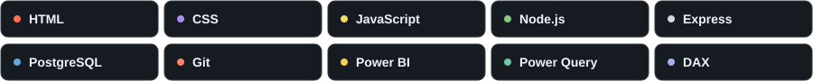
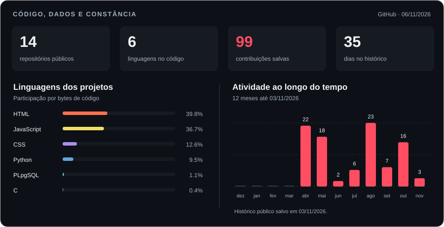

  <picture>
    <source media="(max-width: 600px)" srcset="./assets/banner-mobile.svg?v=motion-1" />
    
  </picture>

  
  &nbsp;
  

## Oi, eu sou o Weslei 👋

Trabalho com performance, processos e tecnologia. Gosto de pegar uma necessidade do dia a dia e transformar em uma solução que facilite a rotina, seja uma aplicação web, uma ferramenta de gestão ou um dashboard.

Por aqui, compartilho meus projetos de desenvolvimento e análise de dados, além do que vou aprendendo na prática.

- **Desenvolvimento:** aplicações com HTML, CSS, JavaScript e APIs em Node.js.
- **Dados:** tratamento de bases, modelagem e dashboards com Power BI.
- **Automação:** ferramentas para reduzir tarefas manuais e organizar informações.

## Tecnologias que uso

## Projetos em destaque

| Projeto | O que construí | Tecnologias |
| :--- | :--- | :--- |
| **[Vitrine V2](https://github.com/Weslei17dev/vitrine-V2)** | Loja virtual com catálogo, carrinho, pedidos, painel administrativo e relatórios. | JavaScript · Node.js · Express · PostgreSQL |
| **[Central de Ferramentas](https://github.com/Weslei17dev/central-ferramentas)** | Central com CRM, agenda, financeiro, estoque e ferramentas de produtividade. | HTML · CSS · JavaScript |
| **[Gerador de Preços](https://github.com/Weslei17dev/Gerador-de-Precos)** | Aplicação para importar produtos em CSV, aplicar regras de preço e exportar os resultados. | HTML · CSS · JavaScript |
| **[Dashboard de Análise Financeira](https://github.com/Weslei17dev/Desafio_Tecnico_WesleiCampos)** | Projeto de BI com tratamento de dados, modelo estrela e análise de receitas, despesas e fornecedores. | Power BI · Power Query · DAX |

<a href="https://github.com/Weslei17dev?tab=repositories">Ver todos os repositórios →</a>

## Meu GitHub em números

<picture>
  <source media="(max-width: 600px)" srcset="./assets/snake-mobile.svg?v=motion-1" />
  
</picture>

Dados consultados no GitHub. Linguagens representam bytes de código dos projetos públicos próprios, sem forks e sem este repositório de perfil; não são uma medida de domínio. Com o perfil privado, a atividade dos gráficos e da cobrinha usa o último histórico público salvo. Repositórios e linguagens continuam atualizados diariamente.

---

<b>Tem uma ideia ou projeto para conversar?</b> 
<a href="https://www.linkedin.com/in/weslei-de-campos-143003282/">Me chama no LinkedIn ↗</a>

